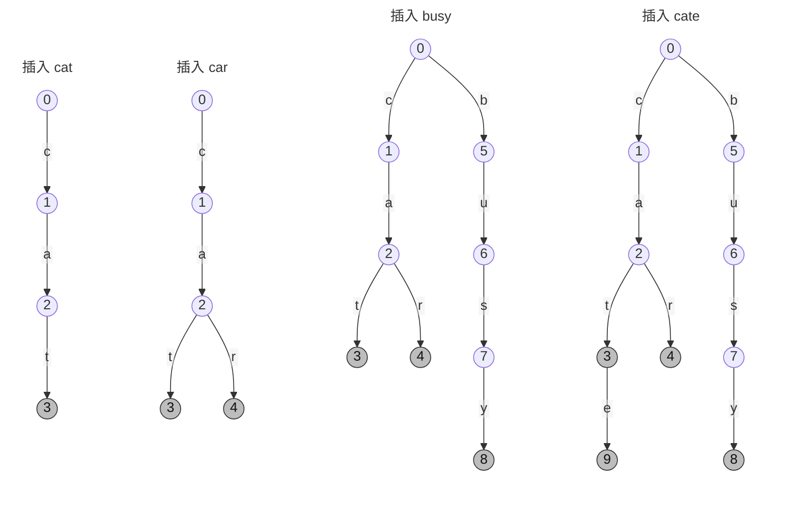

前置知识：
- 二叉树

# Trie 树

> 另名字典树，前缀树

## 简介

> [!quote]  $Trie$ 树分为两种：一种用于存单词，一种用于存整数
> 
> 1. 用Trie存单词
> 	- 由 26个小写字母 构造的 Trie，是一颗26叉树，深度为最长单词的长度
> 2. 用Trie存整数
> 	- 由 整数的十进制位 构造的 Trie，是一颗10叉树，深度为10层
> 	- 由 整数的二进制位 构造的 Trie，是一颗二叉树，深度位31层（int）


$Trie$ 是一种能够快速 **插入** 和 **查询** 字符串 的 <font color="#ff0000">多叉树</font> 结构。
节点的编号各不相同，根节点编号为 $0$，其他节点用来标识路径，
还可以标记单词插入的次数。边表示字符。


> [!info]  $Trie$ 维护字符串的集合，支持两种操作：
>1. 向集合中插入一个字符串，`void insert(char *s)`
>2. 在集合中查询一个字符串，`int query(char *s)`

## 建字典树 $O(m)$

- <font color="#ff0000">儿子数组 </font>$ch[p][j]$ ：
	存储从节点 $p$ 沿着 $j$ 这条边走到的子节点。
	边为26个小写字母(a~z)对应的映射值0~25，
	每个节点最多可以有26个分叉。
	例如，$ch[0][2]=1$，$ch[1][0]=2$，$ch[2][19]=3$。
- <font color="#ff0000">计数数组</font> $cnt[p]$ 
	- 存储以节点 $p$ 结尾的单词的插入次数
- <font color="#ff0000">节点编号</font> $idx$ 
	- 用来给节点编号

1. 空 Trie 仅有一个根节点，编号为0。
2. 从根开始插，枚举字符串的每个字符，
   如果有儿子，则 p 指针走到儿子，
   如果没儿子，则 先创建儿子， p 指针再走到儿子。
3. 在单词结束点记录插入次数。


> [!example] 建字典树代码

```cpp
char s[N];
int ch[N][26];
int cnt[N],idx;
void insert(char *s){
    int p=0;
    for(int i=0;s[i];i++){
        int j = s[i]-'a'; // 字母映射
        if(!ch[p][j]){ // 如果没有节点则新增节点
            ch[p][j]=++idx;
        }
        p = ch[p][j];
    }
    cnt[p]++; // 更新节点的插入次数
}
```

> [!example] 例如
> 依次插入“cat”，“car”，“busy”，“cate”




## 查询 $O(m)$

1. 从根开始查，扫描字符串
2. 有字母 $s[i]$ ，则走下来，能走到词尾，则返回插入次数
3. 无字母 $s[i]$ ，则返回0


> [!example] 查询代码

```cpp
int query(char *s){
	int p = 0;
	for(int i = 0;s[i];i++){
        int j=s[i]-'a';
        if(!ch[p][j])return 0;
        p = ch[p][j];
    }
    return cnt[p];
}
```


## 代码


> [!example] 总代码

```cpp
char s[N];
int ch[N][26];
int cnt[N],idx;
void insert(char *s){
    int p=0;
    for(int i=0;s[i];i++){
        int j = s[i]-'a'; // 字母映射
        if(!ch[p][j]){ // 如果没有节点则新增节点
            ch[p][j]=++idx;
        }
        p = ch[p][j];
    }
    cnt[p]++; // 更新节点的插入次数
}

int query(char *s){
	int p = 0;
	for(int i = 0;s[i];i++){
        int j=s[i]-'a';
        if(!ch[p][j])return 0;
        p = ch[p][j];
    }
    return cnt[p];
}
```


# 01Trie树

**问题的引入：**

题目：
给定 $N$ 个整数 $a_1,a_2…a_N$,

任选两个进行异或运算，得到的结果最大是多少？

$1≤N≤10^{5},0≤ai<2^{31}$

> [!done] 思路
>异或运算 $\rightarrow$ 二进制位 $\rightarrow$ $N$ 个整数均转化为二进制数表示 $\rightarrow$ 二进制是 $01$ 构成的串 $\rightarrow$ 构造 $Trie$ 树 $\rightarrow$ 在树枝上进行异或运算。

## 构建01Trie树

```cpp
const int N = 1e5+5;
int n,a[N];
int ch[N * 31][2],idx;
void insert(int x){
    int p=0;
    for(int i=30;i>=0;i--){
        int j = x>>i&1; //取出第i位
        if(!ch[p][j])ch[p][j]=++idx;
        p = ch[p][j];
    }
}
```


## 查询函数

作用：找到 $x$ 在树上能于其他数字异或出的最大值

```cpp
int query(int x){
    int p=0,res=0;
    for(int i=30;i>=0;i--){
        int j=x>>i&1;
        if(ch[p][!j]){
            res+=1<<i;// 累加位权
            p=ch[p][!j];
        }
        else p=ch[p][j];
    }
    return res;
}
```


## 代码汇总

```cpp
const int N = 1e5+5;
int n,a[N];
int ch[N * 31][2],idx;
void insert(int x){
    int p=0;
    for(int i=30;i>=0;i--){
        int j = x>>i&1; //取出第i位
        if(!ch[p][j])ch[p][j]=++idx;
        p = ch[p][j];
    }
}
// 对于x来说，在树上能异或出的最大值
int query(int x){
    int p=0,res=0;
    for(int i=30;i>=0;i--){
        int j=x>>i&1;
        if(ch[p][!j]){
            res+=1<<i; //累加位权
            p=ch[p][!j];
        }
        else p=ch[p][j];
    }
    return res;
}
int main(){
    cin>>n;
    for(int i=1;i<=n;i++){
        cin>>a[i],insert(a[i]);
    }
    int ans=0;
    for(int i=1;i<=n;i++){
        // 遍历每个值,找到两两异或的最大值
       ans = max(ans,query(a[i]));
    }
    cout<<ans<<endl;
}
```

> 代码没有异或，却做了异或的事 	--------您能领悟到什么哲理吗？
